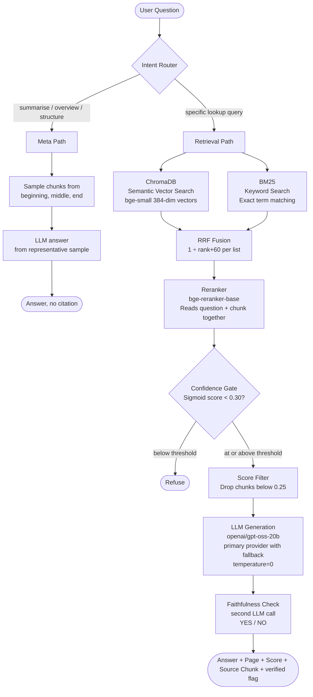
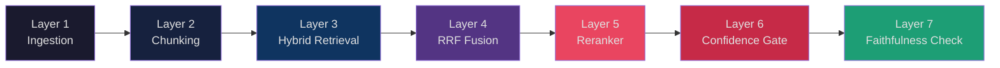
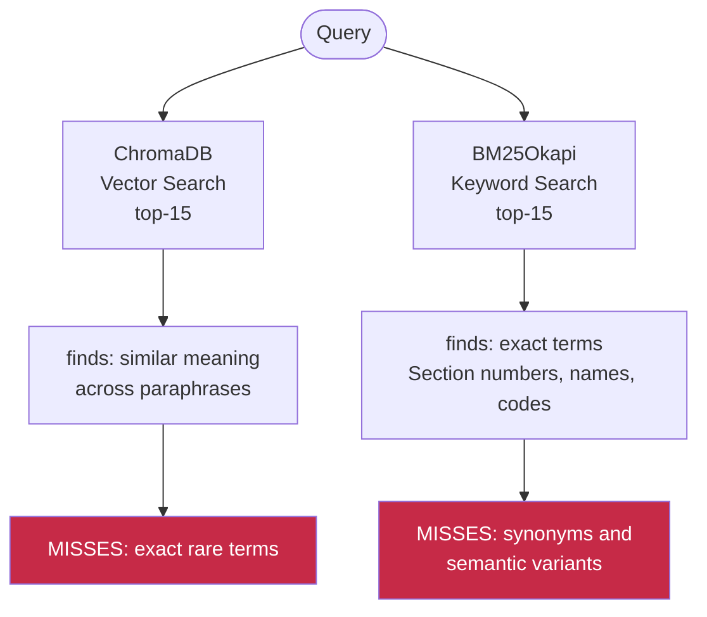
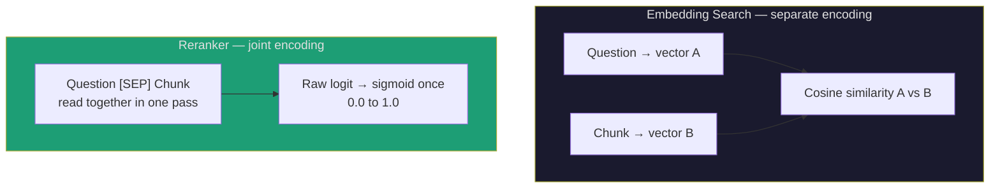
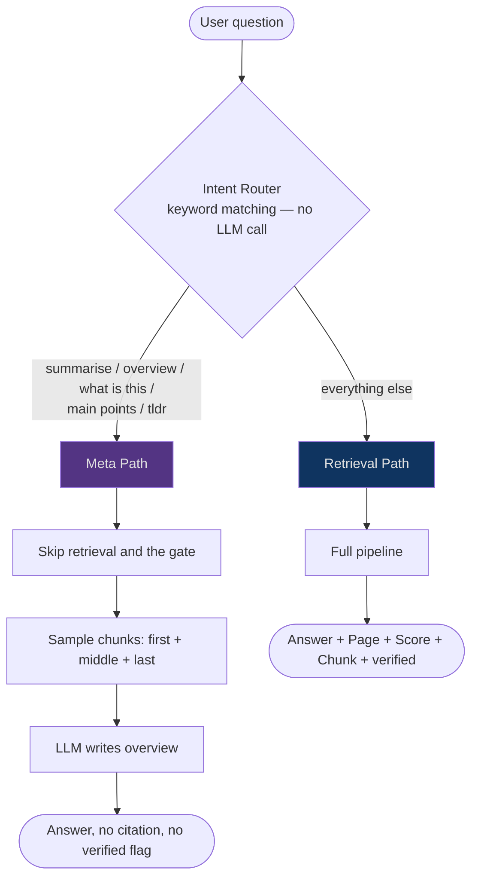

<div align="center">

# LexAI

### Document question answering with retrieval, a confidence gate, and an answer check

**Ask questions about your own documents. Answers cite a page and source chunk, or the question is refused when retrieval evidence is weak.**


</div>

---

## What Is LexAI

LexAI is a Retrieval-Augmented Generation (RAG) system. You upload a PDF or text document and ask questions about it. On the lookup path, each answer comes with the page and source chunks it was generated from. If the best retrieved chunk scores below a confidence threshold, the question is refused instead of being sent to the LLM.

The design goal:

> **Answer from the uploaded documents with a source citation, or refuse.**

Limits of that goal, as the code stands today:
- Summary-style questions ("summarise", "overview", "tldr", …) take a separate meta path that skips retrieval and the confidence gate and returns no citation.
- The faithfulness check reports `verified: true/false` next to the answer; it never blocks or edits the answer.
- The confidence threshold (0.30) is uncalibrated — see [Layer 6](#layer-6--confidence-gate).

---

## Architecture Overview



---

## The Pipeline Layers

The lookup path runs seven steps in order.



### Layer 1 — Ingestion
**Problem it addresses:** Basic PDF extraction can mix up two-column layouts.

**Implementation:** PyMuPDF (imported as `pymupdf`) reads each page's text blocks, splits them at the page's horizontal midpoint, and reads the left column top-to-bottom, then the right column. A section starting with a "References" or "Bibliography" heading line is cut off before chunking. `.txt` files are read as a single page. Only `.pdf` and `.txt` are accepted.

Uploads are de-duplicated — see [Upload de-duplication](#upload-de-duplication).

---

### Layer 2 — Chunking
**Problem it addresses:** Fixed-size character splitting cuts sentences in half.

**Implementation:** A sentence-based chunker targeting about **400 words per chunk with about 40 words of overlap** (`CHUNK_WORDS`, `OVERLAP_WORDS`). Sentences are split with a simple regex on `.`, `!`, `?`. Each chunk is stored with metadata `{file, page, owner_id, file_hash}`.

---

### Layer 3 — Hybrid Retrieval
**Problem it addresses:** Vector search can miss exact rare terms; keyword search misses paraphrases.



**Implementation:** Both searches run independently with k=15. The BM25 index is held in memory and rebuilt from Chroma after every ingest and reset (Chroma is the source of truth). Both searches filter on `owner_id`, and optionally on a `files` list to narrow the search to specific documents. The owner is taken from the verified Supabase access token — see [Authentication](#authentication).

---

### Layer 4 — Reciprocal Rank Fusion
**Problem it addresses:** The two ranked lists need to be merged; a chunk found by both is stronger evidence.

**The formula:**
```
RRF Score = Σ  1 / (rank + 60)
             across all retrievers

(rank is 0-based in the code)
Chunk ranked first by both:   1/60 + 1/60 = 0.0333
Chunk ranked first by one:    1/60 + 0    = 0.0167
```

The top 15 fused candidates go to the reranker.

---

### Layer 5 — Reranker
**Problem it addresses:** Embedding search encodes question and chunk separately, so the two are never compared word-for-word.



**Implementation:** The `bge-reranker-base` cross-encoder scores each (question, chunk) pair. The code requests the raw logit (`predict(..., activation_fn=torch.nn.Identity())`) and applies a sigmoid **once** to get a 0–1 score. The top 5 chunks go forward; chunks scoring below 0.25 are then dropped before generation (at least one chunk is always kept).

**Scoring history:** before 2026-10-14 the score was passed through a sigmoid twice (the library already applies one by default), which confined every score to roughly 0.50–0.73 and meant the 0.30 gate could never refuse. That is fixed. Any confidence number recorded before the fix is not comparable to current ones.

```
sigmoid(x) = 1 / (1 + e^(-x))
Measured on local test pairs (2026-10-14):
  relevant pair      raw logit  +7.90 → 0.9996
  irrelevant pairs   raw logit −10.19 → 0.00004
```

---

### Layer 6 — Confidence Gate
**Problem it addresses:** With weak context, an LLM tends to fill gaps from its own training data.

**Implementation:** If the best reranked chunk's sigmoid score is below `CONFIDENCE_THRESHOLD` (default **0.30**), the query is refused without calling the LLM. The response is *"Not found in the uploaded document(s)."* with `refused: true` and the best score as `confidence`.

**Calibration:** the gate works mechanically — after the scoring fix it refuses off-topic questions (a live smoke test on 2026-10-24 refused the off-topic question). But reranker scores now tend to sit very close to 0 or very close to 1, and the 0.30 value was chosen before the fix and has never been tuned on labeled relevant/irrelevant questions. **Treat 0.30 as uncalibrated.** The `confidence` field shown to users is `round(score × 100)` of the same number.

---

### Layer 7 — Faithfulness Check
**Problem it addresses:** Even with good context, the LLM can add claims the sources don't support.

**Implementation:** After generation, a second LLM call is asked whether every claim in the answer is supported by the sources, replying YES or NO. The reply is parsed for a leading YES or NO (leading punctuation such as `**` is ignored).

- `verified: true` only for a clear YES.
- `verified: false` for NO, for an ambiguous or empty reply, and when the check could not run (for example, both LLM providers unavailable).
- The answer text is returned either way; this check never blocks, edits, or regenerates it.

Generation and verification both use `temperature=0`.

---

## The Two Query Paths

The intent router is keyword matching on the question (no LLM call). Questions containing "summar", "overview", "what is this", "what's this", "tldr", "main points" or "about this" take the meta path.



Follow-up questions on the lookup path are first rewritten into a standalone question by an LLM call ("condense") that sees up to the last 4 turns of chat history. The backend is stateless about this: it keeps no history itself — the caller passes the recent turns on each `/query` call via an optional `history` field (list of `{"q", "a"}`, at most 6 items; `q`/`a` are truncated to 1500 characters server-side rather than rejected). Omitting `history` (or sending none) skips the condense call entirely — the question is used as-is.

---

## LLM Providers, Failover and Circuit Breaker

All LLM calls (condense, generate, verify, meta answers) go through `LLMClient` in `lexai/backend/llm_client.py`, which talks to OpenAI-compatible endpoints.

| Setting (env var) | Default in code | Meaning |
|---|---|---|
| `LLM_PROVIDER` | `groq` | Primary provider (`groq` or `nvidia`) |
| `LLM_MODEL` | provider default | Overrides the primary's model |
| `LLM_FALLBACK_PROVIDER` | `nvidia` | Fallback provider; empty string disables failover |
| `LLM_FALLBACK_MODEL` | provider default | Overrides the fallback's model |
| `LLM_TIMEOUT_S` | `30` | Per-call timeout in seconds; SDK retries are off |
| `LLM_BREAKER_SECONDS` | `60` | How long calls skip the primary after it fails |

Both providers default to the model `openai/gpt-oss-20b` (NVIDIA NIM at `integrate.api.nvidia.com`, Groq at `api.groq.com`). So with no env vars set, Groq is primary and NVIDIA is the fallback; setting `LLM_PROVIDER=nvidia` and `LLM_FALLBACK_PROVIDER=groq` reverses that. Which provider a given deployment uses depends on its `.env`. A live smoke test with Groq as primary passed on 2026-10-24 (per `PROJECT_LOG.md`).

Behaviour:
- **Failover:** if the primary times out, cannot connect, returns 429, or returns another non-400 error (e.g. 5xx), the same call is tried once on the fallback. The fallback is only used if its API key (`NVIDIA_API_KEY` / `GROQ_API_KEY`) is set. A 400 is treated as a bug in the request and is raised without failover.
- **Circuit breaker:** after such a primary failure, and only if a fallback is available, calls go straight to the fallback for `LLM_BREAKER_SECONDS`. After that window one call tries the primary again; if it succeeds the breaker closes, if it fails the window restarts. A 400, or a failure with no fallback configured, never opens the breaker. The breaker state is per server process and in memory.
- **Total failure:** if both providers fail, `/query` returns **HTTP 503** "The language model service is temporarily unavailable. Please try again." A failure during the verify step alone does not cause a 503; it returns the answer with `verified: false`.

`gpt-oss-20b` is a reasoning model, so each call uses `max_tokens=2048` (small budgets can return empty content). The NVIDIA free endpoint has shown intermittent multi-minute stalls; the timeout, failover and breaker limit their impact but do not fix the cause.

---

## Upload De-duplication

On each upload the backend computes the SHA-256 of the file's bytes and stores it as `file_hash` in every chunk's metadata. Before ingesting, it looks for existing chunks with the same `owner_id` and `file_hash`:

- **Found:** nothing is re-ingested. The response is `{"file": "<name the chunks are stored under>", "chunks": <existing count>, "duplicate": true}`.
- **Not found:** normal ingestion; the response is `{"file": "...", "chunks": N}` (no `duplicate` key).

De-duplication is per owner and per exact bytes. A changed file with the same filename is ingested normally, alongside the older chunks (nothing is replaced or deleted). Chunks stored before this feature have no `file_hash` and are never matched.

When the response has `duplicate: true`, the React frontend shows "This file is already in your library", uses the returned (existing) filename, and does not add a second Supabase library row (it adds one only if the library has no row for that filename).

---

## Debug Option on /query

`POST /query` accepts an optional `"debug": true`. The response then includes a `debug` object with per-stage timings, retrieval counts, the reranker's top-5 raw logits and sigmoid scores, the gate comparison, one entry per LLM attempt (provider, model, purpose, outcome — including failed and breaker-skipped attempts — duration, tokens), the verification verdict text and status (`supported`, `not_supported`, `ambiguous`, `check_could_not_run`), and a `refusal_path` string explaining which branch produced the result. Without the flag, no `debug` key is returned.

`smoke_test.py --debug` sends the flag and prints the block.

---

## RAGAS Evaluation

`Evaluvate.py` runs 14 questions (11 factual + 3 whose answer is not in the documents) against the live backend and scores the responses with RAGAS. The questions and the `owner_id` / file names are hard-coded for a specific set of uploaded documents and must be edited for any other setup.

**Current judge in the code:** `openai/gpt-oss-20b` via the NVIDIA NIM endpoint (the judge does not use the backend's failover). Embeddings: `BAAI/bge-small-en-v1.5` (local).

**No current scores.** The only recorded scores are below. They are kept for history only and should not be quoted as current:

| Metric | Old score | What it measures |
|---|---|---|
| Faithfulness | 0.5476 | Share of answer claims supported by the retrieved chunks |
| Answer Relevancy | 0.6770 | How directly the answer addresses the question |
| Context Precision | 0.3679 | Share of retrieved chunks that were relevant |
| Context Recall | 0.4667 | Share of relevant content that was retrieved |

*Old judge: `meta/llama-3.1-8b-instruct` (retired by NVIDIA on 2026-08-26). These scores were also measured before the reranker scoring fix (2026-10-14). To be re-run with the current judge.*

---

## API Endpoints

| Method | Path | Auth | Purpose |
|---|---|---|---|
| `GET` | `/health` | none | Liveness check — returns total paper count and chunk count (all owners) |
| `POST` | `/upload` | token | Upload a `.pdf` or `.txt` — multipart: `file`. See [Upload de-duplication](#upload-de-duplication) |
| `POST` | `/query` | token | Ask a question — JSON: `question`, optional `files` (list of filenames), optional `debug`, optional `history` (list of `{"q", "a"}`, at most 6 items; the backend keeps no history itself — see [Pipeline](#pipeline)). 503 if no LLM provider is reachable |
| `GET` | `/papers` | token | List the caller's documents |
| `DELETE` | `/papers/{filename}` | token | Delete the caller's chunks for that filename (URL-encoded). Returns `{"file": ..., "deleted_chunks": n}`; 404 if the caller has no such file. Other users' files with the same name are not touched |
| `POST` | `/reset` | `X-Admin-Key` | Deletes **all documents of every owner**. Requires header `X-Admin-Key` equal to env `ADMIN_KEY`; disabled (403) when `ADMIN_KEY` is empty; wrong key → 403 |

### Authentication

"token" routes require `Authorization: Bearer <Supabase access token>` (`lexai/backend/auth.py`):

- RS256 / ES256 tokens are verified against the project's public keys at `{SUPABASE_URL}/auth/v1/.well-known/jwks.json` (fetched with PyJWT's `PyJWKClient` and cached in memory). HS256 tokens (legacy shared-secret projects) are verified with `SUPABASE_JWT_SECRET`; if it is unset they are rejected. Any other algorithm, including `none`, is rejected.
- `exp`, `iss` (`{SUPABASE_URL}/auth/v1`), `aud` (`authenticated`) and `sub` are always required. The owner of the request is the token's `sub`; an `owner_id` sent by the client is ignored.
- Every failure returns 401 `Invalid or missing credentials.`
- If `SUPABASE_URL` is unset and `AUTH_DISABLED` is not `true`, the server refuses to start.
- `AUTH_DISABLED=true` is for local development only: token checks are skipped, a warning is printed at startup, and the routes use the client's `owner_id` (form field on `/upload`, JSON body on `/query`, query string on `/papers` and `DELETE /papers/{filename}`; 400 if missing).

This was tested offline with locally generated keys and a mocked JWKS endpoint. It has **not** been tested against a real Supabase project (unverified).

The React frontend sends `Authorization: Bearer <access token>` on every backend call (`/upload`, `/query`, `DELETE /papers/{filename}`) through one helper, `lexai/frontend/src/api.js`, which reads the current Supabase session right before each request. It no longer sends `owner_id`, so it needs a backend with auth enabled; against a backend with `AUTH_DISABLED=true` its requests get 400. On a 401 the frontend signs the user out and shows "Please sign in again"; on a 503 it shows the backend's message. The end-to-end flow with a real Supabase sign-in has not been run (unverified).

CORS allows only the origins in `FRONTEND_ORIGIN` (default `http://localhost:5173`), the methods `GET, POST, DELETE, OPTIONS`, and the headers `Authorization, Content-Type, X-Admin-Key`.

**Lookup-path response shape:**
```json
{
  "refused": false,
  "answer": "...",
  "verified": true,
  "citation": "filename.pdf · p.3",
  "confidence": 87,
  "label": "High",
  "sources": [
    { "file": "filename.pdf", "page": 3, "score": 87, "text": "..." }
  ]
}
```
`label` is `High` at a score ≥ 0.7, `Medium` at ≥ 0.5, otherwise `Low`. A refused answer has `refused: true`, `citation: null`, `sources: []` and no `verified` key. A meta-path answer has `meta: true`, `citation`/`confidence`/`label` set to `null`, `sources: []`, and no `verified` key.

---

## Project Structure

```
LexAI/                          (repository root)
├── README.md
├── CLAUDE.md                   # Notes for the Claude Code agent working in this repo
├── PROJECT_LOG.md              # Append-only work log
├── package.json                # Stray (only @supabase/supabase-js); not used by either app
├── package-lock.json
└── lexai/
    ├── README.md               # Empty
    ├── backend/
    │   ├── api.py              # FastAPI server — all endpoints
    │   ├── lexai_engine.py     # Retrieval / gate / generation / verify pipeline (LexAIEngine)
    │   ├── llm_client.py       # LLM calls: timeout, failover, circuit breaker
    │   ├── auth.py             # Supabase access-token verification (FastAPI dependency)
    │   ├── Evaluvate.py        # RAGAS evaluation script (filename spelled this way)
    │   ├── smoke_test.py       # Upload + answerable/unanswerable query check against a running backend
    │   ├── ragas_results.csv   # Per-question output of the last Evaluvate.py run (old judge)
    │   ├── requirements.txt    # Backend dependencies (lists some packages the code does not import)
    │   ├── .env                # API keys (never committed)
    │   ├── .env.example        # Template with every env var the code reads
    │   ├── chroma_store/       # ChromaDB persistent store (gitignored, created at runtime)
    │   ├── scratch/            # Dev scripts and offline tests (gitignored)
    │   └── mcp_server/         # MCP server — exposes the backend as Claude Desktop tools
    │       ├── server.py       # FastMCP server with 3 tools
    │       ├── requirements.txt
    │       ├── .env            # LEXAI_BACKEND_URL + LEXAI_OWNER_ID (never committed)
    │       ├── .env.example
    │       └── README.md
    └── frontend/
        ├── index.html
        ├── package.json
        ├── vite.config.js
        ├── eslint.config.js
        ├── public/
        └── src/
            ├── main.jsx            # Entry point
            ├── App.jsx             # Sign-in gate, chat, upload, scope selector
            ├── SignIn.jsx          # Google sign-in via Supabase
            ├── Onboarding.jsx      # Profile form (Supabase `profiles`)
            ├── Warning.jsx         # Disclaimer screen
            ├── Library.jsx         # Files and collections manager
            ├── libraryApi.js       # Supabase calls for the library
            ├── api.js              # All backend calls (token header, API URL, 401/503 handling)
            ├── supabaseClient.js   # Shared Supabase client
            ├── *.css               # Per-component styles + index.css
            └── assets/
```

---

## Setup

**1. Clone and create environment**
```bash
git clone https://github.com/ishwaryaaaaaaaaa/lexai.git
cd lexai/backend
python -m venv .venv
.venv\Scripts\activate        # Windows
# source .venv/bin/activate   # Mac/Linux
pip install -r requirements.txt
pip install langchain-openai langchain-huggingface  # only needed for Evaluvate.py
```

**2. Set up environment variables**
```bash
cp .env.example .env
# Edit .env: set NVIDIA_API_KEY and/or GROQ_API_KEY, and choose LLM_PROVIDER /
# LLM_FALLBACK_PROVIDER. Set SUPABASE_URL (or AUTH_DISABLED=true for local
# development only) or the server will not start. See .env.example for every variable.
```

The frontend needs its own `lexai/frontend/.env` (template: `lexai/frontend/.env.example`) with `VITE_SUPABASE_URL`, `VITE_SUPABASE_ANON_KEY` and `VITE_API_URL` (backend base URL; defaults to `http://localhost:8000`, for local development only). The four Supabase tables the frontend uses (`files`, `collections`, `file_collections`, `profiles`) can be created with `lexai/frontend/supabase_schema.sql`: tables, row level security, own-rows policies limited to the operations the app performs, grants to `authenticated` only, and read-only check queries at the end. No trigger is needed (the app creates the profile row itself during onboarding). Tables that already exist are not altered by it; the check queries show their real columns and foreign keys. It has not been run against the real project (unverified).

**3. Run the backend**
```bash
uvicorn api:app --host 127.0.0.1 --port 8000 --reload
# The first run downloads bge-small-en-v1.5 and bge-reranker-base (size unverified)
```

**4. Run the frontend**
```bash
cd ../frontend
npm install
npm run dev
# Vite dev server, usually http://localhost:5173; the app calls the backend at VITE_API_URL
# (default http://localhost:8000). The backend must run with auth enabled (SUPABASE_URL set).
```

**5. Upload a document and query it**
```bash
# Upload (auth enabled: pass a Supabase access token)
curl -X POST http://localhost:8000/upload \
  -H "Authorization: Bearer $TOKEN" \
  -F "file=@your_document.pdf"

# Query
curl -X POST http://localhost:8000/query \
  -H "Authorization: Bearer $TOKEN" \
  -H "Content-Type: application/json" \
  -d '{"question": "What is the main finding?"}'
```

With `AUTH_DISABLED=true` (local development only), drop the `Authorization` header and send `owner_id` instead (`-F "owner_id=your-user-id"` on upload, `"owner_id": "your-user-id"` in the query body). `smoke_test.py --token <access token>` sends the header for you.

---

## Running the RAGAS Evaluation

```bash
cd lexai/backend

# The backend must be running, with the documents named in Evaluvate.py uploaded
# under the owner_id hard-coded there (edit TEST_SET / EVAL_FILES / owner_id first).

python Evaluvate.py   # makes real LLM calls (backend provider + NVIDIA judge); duration unverified

# Results are printed and saved to ragas_results.csv
```

---

## Technical Decisions

| Decision | Alternative considered | Reason given |
|---|---|---|
| `bge-small` not `bge-large` | bge-large (1024-dim) | Memory budget |
| ChromaDB persistent on disk | In-memory vector store | Embeddings survive restarts |
| BM25 alongside ChromaDB | Vector search only | BM25 matches exact technical terms |
| RRF for fusion | Weighted average of scores | RRF uses rank, not score magnitude, so the two retrievers' score scales don't matter |
| Cross-encoder reranker | No reranker | Scores question and chunk together instead of comparing separate embeddings |
| Sigmoid (once) on reranker logit | Raw logit comparison | Gives a 0–1 score that the threshold and the `confidence` field share |
| Confidence gate at 0.30 | Always attempt an answer | Refuse rather than answer from weak evidence (threshold uncalibrated) |
| Chunk score filter at 0.25 | Pass all reranked chunks | Keep weak chunks out of the generation context |
| `temperature=0` | temperature > 0 | More repeatable output |
| No LlamaIndex | LlamaIndex orchestration | Direct control of each step; `llama-index-*` remains in requirements.txt but is not imported |
| React + Vite frontend | Streamlit | Multi-user UI with a per-user library |
| Owner-scoped retrieval | Shared document pool | Every retrieval filters on `owner_id`, which comes from the verified token |
| PyMuPDF | pdfminer | Column-aware block reading |
| Strip references section | Keep all text | Reference lists add frequent terms that distort retrieval |
| Hosted LLM (NVIDIA NIM / Groq) with failover | Local Ollama | No local GPU needed; a second provider covers outages |

---

## MCP Server — Use LexAI from Claude Desktop

A [Model Context Protocol](https://modelcontextprotocol.io) server in `lexai/backend/mcp_server/` exposes the backend as tools for MCP clients such as Claude Desktop. It is a separate process that forwards tool calls over HTTP to the running backend; it contains no RAG logic.

### Tools

| Tool | What it does |
|---|---|
| `ask_lexai(question)` | Calls `/query` and returns the answer, citation, confidence and verification status |
| `upload_to_lexai(file_path)` | Reads a local `.pdf` or `.txt` file and calls `/upload` |
| `list_lexai_documents()` | Calls `/papers` for the configured owner ID |

`/reset` is not exposed as a tool.

### Setup

The `mcp` package is not installed in the backend's `.venv` (checked 2026-10-24). Follow `lexai/backend/mcp_server/README.md`: create a venv for the MCP server, `pip install -r requirements.txt`, then:

```bash
cd lexai/backend/mcp_server
cp .env.example .env
# Set LEXAI_BACKEND_URL (e.g. http://localhost:8000) and LEXAI_OWNER_ID
```

### Connecting Claude Desktop

Add this to `%APPDATA%\Claude\claude_desktop_config.json` (Windows) or `~/Library/Application Support/Claude/claude_desktop_config.json` (Mac), replacing `<REPO>` with the absolute path of your clone and pointing `command` at the Python of the venv where you installed the MCP requirements:

```json
{
  "mcpServers": {
    "lexai": {
      "command": "<REPO>\\lexai\\backend\\mcp_server\\.venv\\Scripts\\python.exe",
      "args": ["<REPO>\\lexai\\backend\\mcp_server\\server.py"]
    }
  }
}
```

Restart Claude Desktop. The backend must be running at `LEXAI_BACKEND_URL`.

> **Single-user mode:** the server uses one fixed `LEXAI_OWNER_ID` for every call and sends no access token, so it only works against a backend running with `AUTH_DISABLED=true`. Multi-user use would need a per-user token.

---

## Stack

| Component | Technology | Purpose |
|---|---|---|
| Backend framework | FastAPI + uvicorn | HTTP API server |
| Frontend | React + Vite | Chat and document library UI |
| MCP server | `mcp` SDK (FastMCP), `mcp[cli]>=1.0.0` | Expose backend as Claude Desktop tools |
| Vector DB | ChromaDB (persistent) | Semantic search storage |
| Embeddings | BAAI/bge-small-en-v1.5 | Local text encoding (384-dim) |
| Keyword search | BM25Okapi (rank-bm25) | Exact term matching |
| Fusion | Custom RRF | Merge ranked lists |
| Reranker | BAAI/bge-reranker-base | Cross-encoder scoring |
| LLM | openai/gpt-oss-20b | Generation, condensing, verification |
| LLM providers | NVIDIA NIM and Groq (OpenAI-compatible API) | Primary + fallback with circuit breaker |
| PDF extraction | PyMuPDF (`pymupdf`) | Column-aware text extraction |
| Sign-in and library | Supabase (frontend only) | Google sign-in, profiles, file/collection records |
| Evaluation | RAGAS 0.4.3 (installed version) | Faithfulness / relevancy / precision / recall |
| Eval embeddings | BAAI/bge-small-en-v1.5 (local) | answer_relevancy without an external API |
| Config | python-dotenv | Environment variables |

---

## Known Limitations

| Limitation | Status |
|---|---|
| React frontend no longer sends `owner_id` | It does not work against a backend with `AUTH_DISABLED=true` (400); run the backend with `SUPABASE_URL` set |
| Frontend token flow not yet tried with a real Supabase sign-in | Unverified live |
| Backend token check not yet tried against a real Supabase project | Tested offline only (unverified live) |
| MCP server sends a fixed `owner_id` and no token | Works only with `AUTH_DISABLED=true` |
| Confidence threshold 0.30 is uncalibrated against current reranker scores | Open |
| RAGAS scores are from a retired judge and predate the scoring fix | To be re-run |
| NVIDIA free endpoint can stall for minutes | Contained by timeout / failover / breaker, not fixed |
| First query after startup is slow (≈106s measured once on 2026-10-13, cold start) | Not re-measured since the LLM client changes |
| Cannot read graphs, charts, or image-based figures | No vision model |
| Scanned PDFs (no text layer) return no chunks | OCR needed before upload |
| Tables and equations extract as flat text | Quality varies (unverified) |
| RAGAS judge output can fail to parse (OutputParserException) | Reported in earlier runs; unverified with the current judge |

---

## What This Is Not

- Not a concept explainer — if the concept is not in your document, a lookup question is refused or answered with "The provided documents do not contain this information."
- Not a paper discovery tool — bring your own document
- Not a writing assistant
- Not a cross-document reasoning tool — queries can be scoped to specific files, but there is no dedicated multi-document comparison

---

## Author

**Ishwarya Mohan**
Metallurgical & Materials Engineering, IIT Kharagpur · AI/ML Engineer
